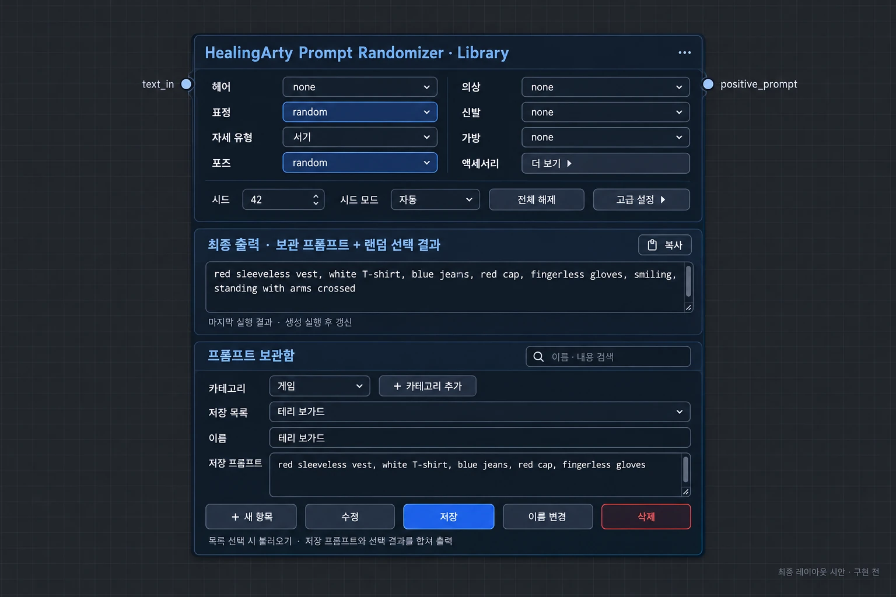

# HealingArty Prompt Randomizer 🎨

## 🎲 새 노드: Prompt Randomizer · Library v1.0

**프롬프트를 이름별로 보관하고, 헤어·표정·의상·자세를 골라 한 번에 출력합니다.**



> AI로 제작한 레이아웃 시안입니다. 실제 실행 화면 캡처가 아니며, 구현된 UI의 배치·문구·로고와 일부 차이가 있습니다.

업데이트 후 **ComfyUI 재시작 → Ctrl+F5 → 노드 검색에서 `HealingArty Prompt Randomizer · Library` 추가**.
기존 **V11 노드는 그대로 유지**합니다. 이전 워크플로를 새 노드로 자동 변환하지 않습니다.

### 화면 구성

- **위:** 헤어·표정·의상·신발·가방. 안경·모자·화장·팬티스타킹은 액세서리 더 보기에서 선택합니다.
- **자세:** 서기·앉기·눕기 중 하나를 고르고, 그 안에서 none / random / 순차 / 직접 선택. 동시에 여러 자세가 출력되지 않습니다.
- **가운데 최종 출력:** 아래 편집창의 문구와 실제 랜덤·순차 선택 결과를 합친 전체 프롬프트. `positive_prompt`와 같은 내용이며 생성 실행 후 갱신됩니다. 설정을 바꾸면 이전 실행 결과라는 안내가 표시됩니다. 복사 버튼을 제공합니다.
- **아래 보관함:** 카테고리와 저장 목록을 클릭해서 고르는 메뉴입니다. 왼쪽 트리는 없으며 긴 목록은 메뉴 안에서 스크롤합니다. 이름·내용 검색을 지원합니다.
- 프롬프트 창은 높이를 조절할 수 있고, 긴 내용은 오른쪽 세로 스크롤로 확인합니다. 좁게 줄이면 노드 내부도 스크롤됩니다.
- 파란 주사위 로고를 표시합니다. 분위기·배경·소품·란제리·수영복·단체 촬영 메뉴는 새 노드에서 제외했습니다. 이 기능이 필요하면 기존 V11을 사용하세요.
- 시드·자동/고정은 기본 화면에, 카테고리별 가중치는 고급 설정에 있습니다. 전체 해제는 선택 항목만 none으로 돌리고 편집 문구·시드·가중치를 유지합니다.

### 저장 예시: 게임 → 테리 보가드

1. **+ 카테고리 추가**에서 `게임`을 만듭니다.
2. **+ 새 항목** → 이름에 `테리 보가드`, 프롬프트에 의상 문구 등을 입력합니다.
3. **저장**을 누릅니다. 같은 카테고리에서 이름이 중복되면 덮어쓰지 않고 안내합니다.
4. 다음에는 카테고리 `게임`과 저장 목록의 `테리 보가드`를 선택하면 즉시 편집창에 불러옵니다. 클릭만으로 생성을 시작하지 않습니다.
5. **수정**을 눌러 문구를 고치고 **저장**, 또는 **이름 변경**으로 저장 이름을 바꿀 수 있습니다.
6. **삭제**는 별도의 빨간 버튼이며 항목 이름을 보여주고 확인합니다. 삭제 후 현재 문구는 편집창에 남아 있습니다.

저장하지 않은 편집 내용이 있을 때 다른 항목으로 이동하거나 새 항목을 만들면 확인합니다.
편집 중인 문구는 다음 생성에 사용되지만, 보관함의 항목을 갱신하려면 **저장**을 눌러야 합니다.
보관함에는 **문구와 이름·카테고리만 저장**하며 랜덤 설정 전체를 저장하는 프리셋 기능은 아닙니다.
카테고리 추가를 지원하며 카테고리 이름 변경·삭제는 이번 범위에 포함하지 않았습니다.

### 연결과 출력

새 노드의 `positive_prompt`를 텍스트 인코더에 연결합니다. 선택적인 `text_in`에 외부 Prompt Manager 등을 연결하면 다음 순서로 합칩니다.

**외부 text_in → 아래 편집창 문구 → 랜덤·순차·직접 선택 결과**

아래 편집창이 유일한 기본 프롬프트 입력창이며 위에 중복 입력창은 없습니다. 원문에 이미 의상·자세가 포함돼 있으면 선택한 설정과 충돌할 수 있으므로 문구를 확인하세요. 모델에 따라 태그·가중치 해석과 자세 반영 정도가 다릅니다. 원본 자세 교체 지시문이나 자동 번역은 이번 버전에 추가하지 않았습니다.

출력: `positive_prompt`, `세부사항`, `사용된_시드`. 같은 고정 시드는 같은 랜덤 선택을 재현하며 순차는 시드와 관계없이 진행합니다. 순차 진행 위치는 실행 중 노드 메모리에 있어 서버 재시작 시 초기화됩니다. 빈 문구와 모든 선택이 none이면 빈 문자열을 출력합니다.

### 저장 위치와 보존

보관함은 ComfyUI 실행 컴퓨터의 `user/default/healingarty_prompt_library.json`에 저장됩니다. ComfyUI 사용자 폴더를 따로 지정했다면 그 경로 아래의 `default`입니다. 서버의 보관함은 여러 노드·워크플로에서 공유합니다. 단일 사용자 로컬 환경을 기준으로 하며 사용자 계정별 격리는 제공하지 않습니다.

저장 시 이전 파일을 `healingarty_prompt_library.json.bak`로 보관하고 임시 파일을 완성한 뒤 교체합니다. 여러 창에서 동시에 바꾸면 오래된 목록으로 덮어쓰지 않고 새로고침을 안내하며 편집 내용은 유지합니다. 잘못된 JSON은 자동 초기화하지 않습니다. 보관함을 다른 PC로 옮기려면 ComfyUI를 종료한 상태에서 JSON을 복사하고 별도로 백업하세요.

워크플로에는 현재 편집 문구와 랜덤 설정을 포함하므로 다른 PC에 보관함이 없어도 현재 문구로 생성할 수 있습니다. ComfyUI-Prompt-Manager의 코드나 저장 파일은 복사·변경하지 않으며 자동 가져오기 기능도 없습니다.

### 검증 범위

기존 V11 검사와 새 노드의 프롬프트 합치기·시드 재현·단일 자세·순차·저장 CRUD·동시 수정 충돌·백업·저장 파일 오류 보존·HTTP API 검사를 수행했습니다. 모의 UI에서 저장·복원·수정·삭제 확인·저장 실패 시 편집 유지·최종 결과 표시·노드 수명주기와 JS 문법을 확인했습니다. 실제 ComfyUI 렌더링·이미지 생성 및 Vue 렌더러는 별도 확인이 필요합니다.

```sh
python -m unittest discover -v
node test_controls.cjs
node test_library_ui.cjs
node --input-type=module --check < js/library.js
```

---

## 기존 V11 안내

ComfyUI용 프롬프트 조합 노드입니다. 기존 워크플로 호환성을 위해 V11 노드 이름과 식별자를 유지합니다.

## 설치 및 업데이트

ComfyUI의 `custom_nodes` 폴더에서 설치합니다.

```cmd
git clone https://github.com/daning1212/HealingaArty_prompt_randomizer.git
```

업데이트는 설치된 `HealingaArty_prompt_randomizer` 폴더 주소창에 `cmd`를 입력하고 실행하세요.

```cmd
git pull
```

ComfyUI를 재시작하고 브라우저에서 **Ctrl+F5**로 새로고침하세요. 이번 버전에는 버튼용 JavaScript가 포함됩니다.
노드 검색에서 `HealingArty`를 찾고 `positive_prompt`를 CLIP Text Encode에 연결합니다.

## 간단한 조작

- 하단 **전체 해제 · 모두 none** 버튼: 선택 메뉴를 모두 `none`으로 변경합니다.
- 시드 숫자, 시드 모드, 가중치, 추가 태그는 그대로 유지합니다.
- 순번을 처음으로 돌리는 버튼이 아닙니다.
- 외부 노드에 연결된 입력은 연결한 노드에서 제어하므로 전체 해제 대상에서 제외됩니다.

| 항목의 선택값 | 동작 |
| --- | --- |
| none | 해당 항목을 출력하지 않음 |
| random | 해당 항목을 무작위로 선택 |
| 순차 | 해당 항목을 차례대로 선택하고 끝에서 처음으로 순환 |
| 직접 선택 | 해당 문구를 고정 출력 |

예: **표정 random + 서서포즈 순차 + 이미지방향 세로 + 의상 직접 선택**.
항목마다 독립적으로 설정합니다. 촬영 인원은 none 또는 1~6명을 직접 선택합니다.

## 시드

| 시드_모드 | 동작 |
| --- | --- |
| 자동 | 매 실행 새 시드 사용 |
| 고정 | 같은 0 이상 시드와 같은 입력으로 랜덤 선택 재현 |

시드 -1은 모드와 관계없이 새 시드를 사용합니다.
표정을 random으로 놓아도 시드가 고정이면 같은 표정이 나올 수 있습니다. 매번 바꾸려면 자동을 선택하세요.
**순차 선택은 시드와 무관하게 계속 진행합니다.**

## 순차 선택

각 카테고리는 첫 항목부터 시작하고 자신의 목록을 한 바퀴 돌면 다시 처음으로 돌아옵니다.
none이나 직접 선택으로 잠시 바꾸면 순차 진행은 멈추며, 다시 순차로 실행하면 이어집니다.
전체 해제는 선택만 비우며 진행 순서를 초기화하지 않습니다.
순번은 노드별 메모리에 저장되므로 ComfyUI 재시작 또는 노드 재생성 시 초기화됩니다.
한 번의 노드 실행마다 한 단계 진행하며 이미지 배치 내부의 이미지마다 변경되지는 않습니다.
실패한 작업에서 이미 실행된 노드의 순서도 진행되었을 수 있습니다.
`세부사항` 출력에서 선택 문구와 순번을 확인하세요.

## 포즈

- **서서포즈 85종:** 기본 스탠딩, 패션 포즈, 손동작, 스트레칭, 걷기, 달리기, 점프, 춤과 스튜디오 포즈.
- **앉기포즈 69종:** 의자·스툴·계단·바닥에 앉기, 무릎 꿇기, 쪼그리기, 스트레칭과 프로필 포즈.
- **누워포즈 56종:** 바로 눕기, 엎드리기, 옆으로 눕기, 기대기, 휴식과 바닥 운동 포즈.
- `이미지방향`은 자세와 별개입니다. 세로, 가로, 정사각 구도를 직접 선택하거나 random·순차로 사용할 수 있습니다.
- 예: **누워포즈 + 세로 구도**, **서서포즈 + 가로 구도**처럼 자유롭게 조합할 수 있습니다.
- 자동 선택용 자세 목록은 코드의 `POSTURE_POSES`에서 관리합니다.
- 포즈 문구는 꽃·커피·휴대폰이나 특정 의상을 자동으로 추가하지 않습니다.
- 모델이 자체적으로 만드는 소품이나 해부학적 오류까지 막는 기능은 아닙니다.

## Edit 모델 의상 교체

- `의상제거`를 켜면 원본 의상을 완전히 제거하고 새 의상으로 교체하라는 영문 지시문을 출력합니다.
- 같은 실행에서 `의상`, `란제리`, `수영복`, `팬티스타킹`, `신발` 중 원하는 항목을 선택하면 교체 대상 의상이 함께 출력됩니다.
- 의상제거만 켜고 새 의상을 선택하지 않으면 모델마다 결과가 불명확할 수 있으므로, 교체할 항목도 같이 지정하는 것을 권장합니다.
- 일반 의상 40종, 란제리 25종, 신발 40종이 추가되었습니다.
- 팬티스타킹은 36종의 새 독립 카테고리이며 자체 가중치와 random·순차 선택을 지원합니다.

## 프로필·단체 촬영: 1~6명

1. `촬영_인원`을 1~6 중 선택합니다.
2. `프로필_단체포즈`에서 random, 순차 또는 원하는 배치를 선택합니다.
3. 필요하면 실내장소를 studio로 설정합니다.

정면 나란히, 몸을 살짝 틀기, 팔짱 프로필, 앉아서 촬영, 높낮이 두 줄, 반원, 대각선, 함께 걷기, 편하게 기대기, 손 흔들기, 뒤돌아보기, 앉아서 몸 틀기의 **12가지 배치**가 인원수에 맞춰 출력됩니다.

단체 포즈가 활성화되면 서기·앉기·눕기 개인 포즈는 출력에서 제외하여 충돌을 줄입니다. 이미지방향 선택값은 유지됩니다.
촬영 인원이 none이면 프로필·단체 포즈는 출력하지 않습니다.
촬영 인원만 선택하면 인원 문구만 추가할 수 있습니다.

인원을 선택하면 추가 태그의 `1girl/1boy/1woman/1man`을 출력에서 제거합니다. 2명 이상이면 `solo`도 제거합니다.
추가 태그 입력칸의 원문은 바꾸지 않습니다. 다른 사용자 작성 인원 문구는 직접 확인하세요.
현재 인원 문구는 성인 기준이며, 공통 표정·의상 설정은 함께 적용됩니다. 사람별 별도 설정은 지원하지 않습니다.
실제 이미지의 인원 정확도는 모델에 따라 달라집니다.

## 가중치 및 출력

가중치는 선택 확률이 아닌 프롬프트 강조값입니다. 예: 1.2 → `(smiling:1.2)`.
1.0이면 일반 문구로 출력합니다. 해석은 연결된 인코더·모델에 따라 다릅니다.

| 출력 | 내용 |
| --- | --- |
| positive_prompt | 조합된 프롬프트 |
| 세부사항 | 시드, 선택 항목, 순차 순번 |
| 사용된_시드 | 실제 사용한 시드 |

추가 태그는 마지막에 붙습니다. 모든 선택과 추가 태그가 비어 있으면 기존 기본값 `1girl`을 출력합니다.

## 이전 워크플로

UI에서 이전 전체 순차 모드로 저장한 워크플로를 불러오면, random으로 선택했던 각 항목을 순차로 옮깁니다.
이전 완전랜덤 모드는 시드 자동으로 변경됩니다. 기존 순차 시작번호·리셋 입력은 제거되며 순번은 처음부터 시작합니다.
이전 API 형식의 `랜덤_모드`는 새 `시드_모드`와 항목별 순차 설정으로 수정해야 합니다.
이미 열려 있던 화면은 반드시 재시작·새로고침하세요.

## English

Per-category controls: none / random / sequential (`순차`) / manual selection.
The clear-all button sets category menus to none while preserving seed, weights and extra tags.
Linked inputs stay controlled upstream. Clear-all does not reset sequence counters.

Seed mode is fixed or automatic. A fixed seed repeats random selections; sequential categories advance independently.
Postures are split into 85 standing, 69 sitting/kneeling, and 56 lying/reclining poses.
Canvas direction is independent: portrait, landscape, or square can be combined with any posture.
An edit-model clothing-removal toggle is included, plus expanded everyday outfits, lingerie, footwear, and a separate 36-item pantyhose category.
Profile/group poses support 1–6 adults with 12 count-aware layouts. Active group poses suppress individual vertical/horizontal pose output.
The default single-person extra tags are removed from output when a count is selected; input text remains intact.
Actual image headcount depends on the model.

Update with git pull in the node folder, restart ComfyUI and refresh with Ctrl+F5.

## 개발 검사

```cmd
python -m unittest discover -v
node test_controls.cjs
```

Python 검사는 생성 로직을, JavaScript 검사는 모의 노드에서 전체 해제·설정 보존·저장/복원·이전 설정 변환을 확인합니다.
실제 ComfyUI 화면 및 이미지 생성 검사는 별도입니다.

Made by @daning1212.


### 저장 복원 호환성 업데이트
- 워크플로 탭 전환과 재로드 시 선택값과 가중치가 밀리는 문제를 수정했습니다.
- 이전 저장 파일의 앞쪽 null 값과 잘못된 이름별 설정을 복구합니다.
- 이미지방향은 가로(기본)/세로 토글입니다. 프롬프트 구도만 지정하며 실제 해상도는 변경하지 않습니다. 이전 none/random/정사각형 선택은 가로로 변환됩니다.
- text_in STRING 입력 포트에 다른 노드를 연결하면 해당 텍스트 뒤에 선택한 태그를 붙입니다.
- 전체 해제 버튼은 저장 순서의 안정성을 위해 노드 하단에 표시됩니다. 방향 토글은 유지합니다.
- 업데이트 후 ComfyUI를 재시작하고 브라우저에서 Ctrl+F5로 새로고침한 뒤 기존 워크플로를 열어 저장하세요.
